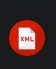

# Lenguaje de marcas UD1

## Definiciones lenguajes de marcas

### Definición

Lenguaje de marcas: Organiza información mediante una sintaxis basada en marcas o etiquetas 

### Tipos de lenguaje de marcas

|Tipo|Para qué sirve|Ejemplos|
|----|--------------|--------|
|Presentación|Muestra contenido formateado|*HTML, CSS*|
|Descriptivo|Intercambio informacion|*XML, JSON*|
|Documentación|Documentar proyectos|*Markdown, LaTex*|

## Instalación y configuración del entorno de trabajo

1. Instalar [Visual Studio Code](https://code.visualstudio.com/)
2. Instalar plugins
   - HTTML CSS Support
   - Live Preview
   - Markdown All in One
   - XML - Red Hat
3. Instalar Git
 ```bash
sudo apt install git
```

## Plugins instalados

|Nombre|Imagen|Uso|
|-|-|-|
|**HTTML CSS Support**||Ayuda con sintaxis y autocompletado CSS|
|**Live Preview**||Visualizar presentación de HTML|
|**Markdown All in One**||Visualizar presentació de Markdown|
|**XML - Red Hat**||Ayuda con sintaxis y autocompletado XML|
